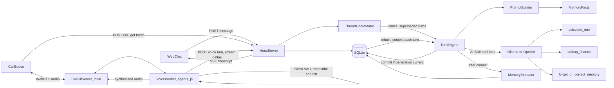

# Sara v1 chat harness and voice call (TypeScript + Vercel AI SDK + LiveKit)

## Guiding principle
The model handles warmth, phrasing, intent and language mixing. Code handles numbers, facts, memory writes, ordering and cancellation. Every finance number Sara states comes from either the EMI tool or a dated knowledge-base record, on both channels.

## Status (22 Nov 2026)

| Area | State |
| --- | --- |
| Phase 0: scaffold, schema | Done |
| Phase 1: AI SDK streaming, chat UI, replay check | Done |
| Phase 2: finance accuracy | Partly done |
| Phase 3: memory | Done |
| Phase 4: language and bursts | Partly done |
| Phase 5: text evals | Not started |
| Voice (Part B) | Local browser MVP merged. Voice evals and tuning pending. |
| Docs, latency report, recording | Partly done |

What exists today:
- **Server and UI.** Hono server with SSE events (`typing`, `delta`, `done`, `cancelled`, `memories`), a chat page with a user picker, history resume and a memory panel, and `client_message_id` deduplication.
- **Turn engine.** Each turn builds AI SDK instructions from the channel prompt and saved facts, then streams against the latest model-facing messages from SQLite and the current tools. Conversation messages use an estimated half of the configured context window, with a default budget of 2,048 tokens. Output is capped at 120 tokens per model call. A turn commits only while its generation is still current. Run `pnpm check:replay` to verify that saved tool results still work after reopening SQLite with `store: false`.
- **EMI.** `calculate_emi` uses `decimal.js` and rounds half-up to paise, including half-paisa ties.
- **Ungrounded-number guard.** It logs a warning when a reply contains a ₹ amount or % that appears in neither the tool outputs nor the user's text. It understands lakh, crore and Devanagari digits.
- **Memory.** A background extractor uses AI SDK structured output to propose add, update and delete operations, and the store keeps one active row per key. The `forget_or_correct_memory` tool runs inside the turn. A forget hard-deletes the fact and hides the whole generations that mention it from future context. Extractions older than the latest forget are rejected.
- **Bursts.** A new message aborts the in-flight reply, the UI drops the partial bubble, and the next generation sees the earlier unanswered messages through history.
- **Voice.** Browser calls share the chat coordinator, tools, history and memory. The local stack uses Silero VAD, Whisper small, macOS speech and Ollama Qwen 3.5 9B. Browser playback, speaking over Sara, and English and Hindi recall passed smoke checks. A Hinglish utterance was misheard.

Gaps found in the current code:
- `lookup_finance` is a stub that returns no records. There is no `kb/finance.yaml`.
- There is no `language.ts`. Language mirroring is a prompt instruction only.
- The coordinator has no debounce.
- **Bug:** memory extraction only sees the message that triggered the committed generation. In a burst, facts in earlier messages whose generations were aborted never get extracted.
- `decisions.md` has only decision #1.

## Tech stack
- **Runtime:** Node 24 LTS, TypeScript, pnpm 11, `tsx` for dev.
- **Server:** Hono with `@hono/node-server` and `streamSSE`.
- **Agent loop.** The Vercel AI SDK streams replies from the configured provider. Tools use zod schemas, and cancellation uses `AbortSignal`.
- **Models:** model IDs live in `.env`.
  - Ollama defaults to local `qwen3.5:9b` for conversation and memory extraction. Text and voice use the same settings.
  - The optional OpenAI provider defaults to `gpt-6.1-terra` with reasoning `none` for conversation and `gpt-6-luna` for extraction.
- **Storage:** SQLite via `better-sqlite3` in WAL mode. There is one thread per user, shared by text and voice.
- **Finance grounding:** about 30 curated YAML records, each with a fact, source URL, `effective_date` and `as_of`. They are validated with zod at boot. There is no vector DB and no live web search.
- **Voice:**
  - **Media server:** LiveKit server running locally on this Mac. Install it with `brew install livekit` and run `livekit-server --dev`, which listens on `ws://127.0.0.1:7880` with key `devkey` and secret `secret`.
  - **Agent worker:** LiveKit Agents for Node (`@livekit/agents` 1.x).
  - **Voice activity and turn detection.** Silero VAD handles local endpointing and interruptions.
  - **Local speech.** Whisper small transcribes ended utterances. macOS `say` uses Tara for Latin-script replies and Lekha for Devanagari.
  - **Optional hosted speech.** Sarvam Saaras v3 in `codemix` mode and Bulbul v3 are available through the speech plugin. This path needs a test call.
  - **Browser and tokens.** Hono serves the `livekit-client` browser bundle and uses `livekit-server-sdk` for room-scoped tokens.
  - **Why not Pipecat:** its server side is Python-only, and we are staying in TypeScript.
- **Tests and evals:** Vitest for unit checks, plus a `tsx` YAML conversation runner that writes a Markdown report.

## Architecture

**How the turn engine works**

- Each turn reconstructs its prompt and message history from SQLite and runs a fresh AI SDK tool loop.
- The coordinator owns an `AbortController` per generation.
- When a run ends, the engine persists the new assistant and tool messages in one transaction, but only if its generation ID is still current.
- Because every turn reads from SQLite, text and voice can't drift apart, and a "forget" takes effect on the next turn on either channel.

**How the two channels stay one Sara:**
- `TurnEngine.run({ userId, channel, utterances, signal })` is the only way to produce a reply. Voice does not get its own LLM, memory or history.
- **The worker handles audio.** Its LiveKit LLM adapter takes the final caller transcript, sends it to the backend and streams the backend reply to speech synthesis.
- **The coordinator stays the single owner of each user's thread,** so ordering, abort, generation IDs and memory extraction behave the same on both channels. An in-process LLM inside the worker would need a second coordinator and a second writer to SQLite.
- **`channel` selects a style overlay.** Text allows ₹ and numerals. The voice prompt asks for one or two short sentences and spelled-out numbers and currency.
- **Live call transcripts.** Voice turns are published on the same SSE stream tagged `channel: "voice"`, so the chat page shows the call transcript live. After the call, the same history and memory panel show what was said.

## Repo layout
Paths marked "(planned)" are part of the roadmap.
- [src/server.ts](../src/server.ts) has these routes:
  - Existing: `POST /api/users/:uid/messages`, `GET /api/users/:uid/events` (SSE), `GET /api/users/:uid/history` and `GET /api/users/:uid/memories`.
  - `POST /api/users/:uid/call` returns the LiveKit URL and a room-scoped token that dispatches Sara.
  - `POST /api/voice/users/:uid/turn` uses worker bearer authentication and streams one generation. A disconnect cancels that generation while it is active.
- [src/engine/coordinator.ts](../src/engine/coordinator.ts) shares one reply task per thread, with an `AbortController` and a generation ID.
- [src/engine/turn.ts](../src/engine/turn.ts), [src/engine/models.ts](../src/engine/models.ts), [src/engine/messages.ts](../src/engine/messages.ts), [src/engine/prompt.ts](../src/engine/prompt.ts), [src/engine/financeNumbers.ts](../src/engine/financeNumbers.ts), and `src/engine/language.ts` (planned).
- [src/memory/](../src/memory/): store, extractor and operations.
- [src/tools/](../src/tools/) contains the registry and tools `emi.ts`, `financeKb.ts` and `memoryTool.ts`, with `kb/finance.yaml` planned.
- [src/voice/worker.ts](../src/voice/worker.ts) contains the LiveKit worker, backend adapter and timing logs. [src/voice/local-speech.ts](../src/voice/local-speech.ts) implements the macOS speech path.
- [scripts/voice-smoke.mjs](../scripts/voice-smoke.mjs) verifies shared recall and transcribes the received LiveKit audio.
- [src/db.ts](../src/db.ts), [web/index.html](../web/index.html).
- `evals/` (planned) contains `conversations.yaml`, `run.ts` and `reports/`.
- `test/` contains the offline turn-engine checks.
- The planned documents are `design-note.md`, `latency-report.md` and `voice-test-calls.md`.
- [decisions.md](../decisions.md).

## Remaining phases

The estimates below are per phase. Follow the assignment order and finish the chat harness first. See the cut list if time runs short.

### Phase 2b: Finish finance accuracy (1h)
- Write `kb/finance.yaml` with about 30 records, validated with zod at boot. `lookup_finance` returns the matching records with source and dates, or an explicit "no record". Topics to cover:
  - MUDRA tiers, including Tarun Plus
  - PMEGP and CGTMSE
  - GST registration thresholds and the composition scheme
  - GST 2.0 rates (5, 18 and 40 from 22 Sep 2025)
  - GSTR-1 and GSTR-3B dates
  - Rule 46 invoice fields and e-invoice thresholds
  - CIBIL range, the free report and disputes
- List valid topic IDs in the tool description so the model can pick them.
- Add Vitest tests for:
  - **EMI vectors:**
    - ₹5,00,000 at 12% for 36 months gives ₹16,607.15.
    - ₹1,00,000 at 0% for 12 months gives ₹8,333.33.
    - ₹1,00,000 at 12% for 12 months gives ₹8,884.88.
    - A half-paisa tie.
  - **The ungrounded-number guard:** lakh and crore, Devanagari digits and percentages.
  - **The knowledge-base loader:** it rejects records that have no source or date.
- Decide whether the guard stays warn-only or blocks and regenerates once. Record the choice in `decisions.md`.

### Phase 4b: Language, bursts, and a channel-aware coordinator (1h)
- **Language (`language.ts`):**
  - Detect script with a Unicode check for Devanagari (U+0900 to U+097F) and a small list of romanised-Hindi markers.
  - The output is a reply-language directive: mirror the user's latest substantive message.
  - Short messages like "ok" or an emoji fall back to the previous language.
  - An explicit "always reply in Hindi" is stored as a sticky `language_pref` memory.
  - Mixed Devanagari and Latin input counts as Hinglish, not Hindi. This matters because Saaras `codemix` transcripts look like that.
- **Bursts:**
  - Add a 1.5s trailing debounce for text, and none for voice, because LiveKit endpointing has already waited.
  - A turn's `utterances` become all user messages since the last committed assistant reply.
  - **Fix the extraction bug:** the extractor receives all of those messages, not only the last one.
- The coordinator already accepts a channel and the voice route has a cancellable per-generation stream.

### Phase 5: Text evals and two tuning rounds (1.5h)
- About 12 YAML conversations across English, Devanagari Hindi and Hinglish. They cover:
  - recall after a detour and in a new session
  - correcting a fact, then forget-and-probe
  - switching English to Hindi to Hinglish
  - the three EMI vectors, plus EMI with the tenure missing
  - a knowledge-base fact (the GST threshold)
  - honesty outside the knowledge base (a specific bank's rate)
  - a three-message burst, and a message sent mid-reply
  - a stressed user, where Sara should be friend first and then offer one practical step
- Add a voice-style subset that runs the same engine with `channel = "voice"`. It checks for no symbols, markdown or lists, and at most two sentences.
- Deterministic checks:
  - EMI exact to the paisa
  - three sentences or fewer, splitting on `.`, `?`, `!` and `।`
  - script matches the expected language
  - banned phrases ("ask your CA") absent
  - memory state and recall
  - no ungrounded numbers
- LLM-judge checks, each pass or fail with a quoted excerpt: tone, natural mixing, friend first.
- Write `evals/reports/round1.md` and `round2.md`, with what changed between them.

### Phase V1: Local LiveKit spike (done)
- Browser microphone and playback work with the local LiveKit server and named `sara` agent. The speech and conversation models ran on the Mac.
- Test optional Saaras v3 code-mix and Bulbul v3 and record the stack decision in `decisions.md` during evaluation.

### Phase V2: Voice front door on the shared harness (done for MVP)
- The browser can call and hang up. Live call transcripts share the chat timeline, and voice transcripts feed the existing memory extractor.
- The worker streams finalized transcripts through the shared coordinator. When interrupted, it closes the stream and the coordinator cancels any generation in progress. A committed reply stays in history even if the caller heard only part of it.
- If test calls reveal a continuity problem, use the TTS-aligned transcript to persist or truncate a reply to the portion actually spoken.

### Phase V3: Sounding like speech (0.5h)
- The voice prompt already asks for one or two short sentences without lists or markup. The spoken lead-in before a tool call ("ek second, nikaalti hoon") is pending.
- **Numbers in code:**
  - The model still writes digits on voice, so the ungrounded-number guard keeps working.
  - `speakable.ts`, used in the worker's `ttsNode`, converts ₹ amounts, lakh and crore, and percentages into words in the reply language.
  - Rupee amounts are rounded to the nearest rupee when spoken, while the stored transcript keeps the exact paise.
- **Script and text-to-speech language:**
  - For Hindi or Hinglish voice replies, Hindi words go in Devanagari and English words stay in Latin script, so Bulbul `hi-IN` pronounces both.
  - The text-to-speech language is set per turn from the language directive: `en-IN` or `hi-IN`.

### Phase V4: Messy callers (0.75h)
- VAD-based barge-in stopped playback and started a new turn in a local test. Verify false interruptions with laptop speakers and ambient noise.
- **Pauses mid-sentence:** use the multilingual turn detector, with the endpointing minimum and maximum delay tuned in test calls. Start at about 0.5s and 3s.
- **"Hello?" into silence:**
  - If a short check-in ("hello?", "haan?", "are you there") arrives while a generation is pending, don't abort and restart, because that resets the wait. Instead, Sara says a quick "haan, sun rahi hoon" and the reply continues.
  - If no first audio is ready after about 2.5s, Sara plays a short filler.
  - If the user goes quiet after Sara speaks, she checks in once after about 8s. After a further silence, she says a warm goodbye and ends the call.
- **Calling back later about something else:**
  - On call start, Sara greets from a template, without a model call, so the greeting is instant. The template uses the user's name and language preference from memory.
  - The prompt gets a "new call; last contact was on <channel>, <time> ago" note, so she uses memory but doesn't resume the old topic as if mid-sentence.
- **Text during a call:** a text message sent during a call goes through the same coordinator. Document what happens: it aborts the voice reply. Fix this only if it looks bad in test calls.

### Phase V5: Latency, test calls and fixes (1h)
- The local smoke call reached voiced reply audio in 2.3s. Whisper took 0.5s, the backend returned its first token in 0.2s, and TTS returned its first PCM chunk in 0.7s. See the [README](../README.md) for the test setup.
- Fixed corrupt playback caused by the native audio bridge reading from the start of shared PCM buffers. The smoke test now transcribes received audio and checks for the expected spoken word.
- **What "fast enough" means:** measured from when the user stops speaking to Sara's first audio:
  - turns without a tool: p50 at or under 1.2s and p90 at or under 2.0s
  - tool turns: may add about 0.8s, covered by the spoken lead-in
- **Planned measurement and reporting:**
  - Extend the worker's existing endpointing, transcription, backend first-token and TTS metrics with consistent per-turn correlation.
  - The server logs submit, model request start, first delta, tool start and end, and commit.
  - Records are joined on `generationId` into `data/latency.jsonl`.
  - `pnpm latency:report` writes p50 and p90 per stage to `docs/latency-report.md`, split by tool and no-tool turns and by language.
  - The smoke test measures up to the caller's first voiced frame. Measure browser playout separately for the report.
- **Preemptive generation stays off at first.** It would persist user messages before the transcript is final and churn aborts. Turn it on only if the report shows endpointing dominates, and only with "don't persist until committed".
- **Test calls:**
  - At least 6 calls covering: English, Hindi and Hinglish; EMI by voice; a knowledge-base fact by voice; an interruption mid-answer; a long pause mid-sentence; "hello?" during a slow reply; and a call-back after a chat about a different topic.
  - Use headphones and also laptop speakers, to see echo-driven self-interruption.
  - Log every problem in `docs/voice-test-calls.md` with severity and fixed or unfixed. Fix the top ones, re-run the latency report, and list what's left unfixed and why.

### Phase 7: Docs, design note and recording (1h)
- The README and `.env.example` cover starting the server, the worker and local LiveKit. Time a fresh setup before claiming the under-10-minute target.
- **Design note, at most two pages:**
  - how a turn flows on each channel
  - how the channels stay one Sara
  - the trust split
  - how the model factory could add Gemini through an AI SDK adapter and a provider setting
  - what we cut and why
  - what we'd change with more time
- Latency report, eval reports and the test-call log, linked from the README.
- **Screen recording, at most 5 minutes:**
  - In chat, the user mentions their shop and an upcoming event, and asks for an EMI.
  - Then a call where Sara recalls the shop and event unprompted, gets interrupted once, and the transcript appears in the chat.

## Deliverables checklist (from ASSIGNMENT.md)

| Deliverable | Where |
| --- | --- |
| Chat harness and web chat (Part A) | Done except the knowledge base, language policy and debounce (Phases 2b and 4b) |
| Voice call from the browser (Part B) | Local MVP merged. Phases V3 to V5 cover speech quality and evaluation. |
| Tests | Turn-engine checks and `pnpm check:voice` run locally. Finance coverage and conversation evals are pending. |
| README, clone to chat and call in under 10 minutes | Setup documented. Fresh-clone timing pending. |
| Design note, at most two pages | `docs/design-note.md` (Phase 7) |
| Test conversations in English, Hindi and Hinglish, two tuning rounds | `evals/reports/` (Phase 5) |
| Latency report for the call | `docs/latency-report.md` (Phase V5) |
| Found and fixed voice problems, plus what's left unfixed | `docs/voice-test-calls.md` (Phase V5) |
| Screen recording, at most 5 minutes | Phase 7 |
| One argued improvement, if time remains | Design note. Current candidate: change the ungrounded-number guard from warn-only to block and regenerate once, because a wrong rupee figure costs more trust than a slower reply. |

## Cut list if time runs short
This list cuts from voice only, never from the chat harness. Items are listed in the order we'd drop them:
1. The "hello?" check-in during a pending reply. Keep only the silence filler.
2. Switching the text-to-speech language per turn. Fix it to `hi-IN`, which handles English words acceptably.
3. Persisting interrupted partial replies. Keep abort-only, and note that the transcript may contain lines the user didn't hear.
4. The voice-style eval subset. Rely on the test calls.

Not cuttable: same memory and history across channels, barge-in, the latency report and the test-call log.

## Trust split (for the design note)
- **Trusted to the model:** empathy, small talk, deciding when money is relevant, intent and argument extraction for tools, telling Hinglish from Hindi, phrasing, and spoken lead-ins.
- **Enforced in code:**
  - EMI arithmetic
  - regulatory facts (the dated knowledge base)
  - memory writes and forget
  - message ordering, deduplication and cancellation
  - the output token cap
  - the language directive and text-to-speech language
  - ungrounded-number detection
  - numbers to spoken words
  - turn-taking, barge-in and silence timers
  - what counts as "heard" after an interruption
