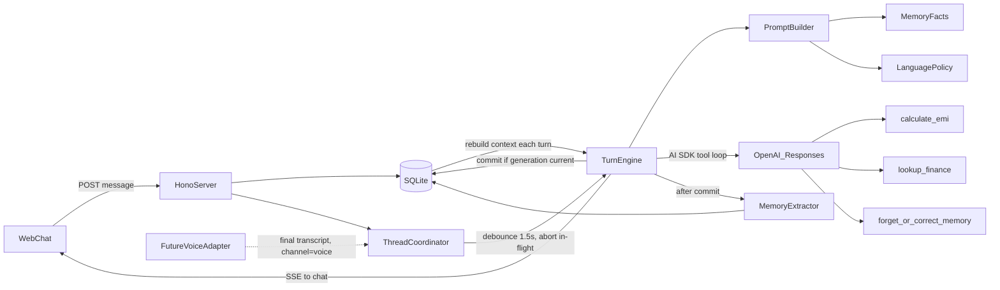

# Sara v1 text chat harness (TypeScript + Vercel AI SDK, voice-ready)

## Guiding principle
The model handles warmth, phrasing, intent and language mixing. Code handles numbers, facts, memory writes, ordering and cancellation. Every finance number Sara states comes from either the EMI tool or a dated knowledge-base record.

## Tech stack
- **Runtime:** Node 24 LTS, TypeScript, pnpm, `tsx` for dev. Node is not installed on this machine yet, so installing it is step one.
- **Server:** Hono with `@hono/node-server`. It serves the static page and has a built-in SSE helper (`streamSSE`).
- **Agent loop.** The Vercel AI SDK (`ai@7.0.179` and `@ai-sdk/openai@4.0.122`) streams OpenAI Responses with `store: false`. Tools use zod schemas, and cancellation uses `AbortSignal`.
- **Models:** model IDs live in `.env`, so swapping one is a config change.
  - Chat turn: `gpt-6.1-terra`, reasoning `none`. Fall back to `gpt-6.2-sol` at `low` if it fails the Hinglish evals.
  - Memory extractor runs `gpt-6-luna` through the AI SDK with a zod schema for structured output.
- **Storage:** SQLite via `better-sqlite3`, WAL mode. SQLite is the source of truth, and there is one thread per user shared by every channel.
- **Finance grounding:** about 30 curated YAML records with fact, source URL, `effective_date` and `as_of`, validated with zod at boot and served by a lookup tool. No vector DB and no live web search.
- **Money math:** `decimal.js`.
- **UI:** one static `web/index.html` with vanilla JS, a user picker (no auth) and a memory side-panel for demo and debugging.
- **Tests and evals.** `pnpm test` runs the offline turn-engine checks with Vitest. The planned `tsx` YAML conversation runner writes a Markdown report.

## Architecture

**How the turn engine works**

- Each turn builds AI SDK instructions from the channel prompt and saved facts, then streams against the current tools and a context window of up to 12 model-facing messages from SQLite.
- The coordinator owns an `AbortController` per generation.
- When a run ends, the engine persists the new assistant and tool messages in one transaction, but only if its generation ID is still current.
- This keeps text and voice from drifting apart and makes a "forget" take effect immediately.

**The voice seam:** `TurnEngine.run({ userId, channel, utterances, signal }): AsyncIterable<SaraEvent>` is the only entry point. `channel` selects a style overlay: text allows ₹ symbols and numerals, while voice will use spoken numbers and no symbols.

## Repo layout
- [src/server.ts](src/server.ts): routes `POST /api/users/:uid/messages`, `GET /api/users/:uid/events` (SSE), `GET /api/users/:uid/history`, `GET /api/users/:uid/memories`. Also serves `web/`.
- [src/engine/coordinator.ts](src/engine/coordinator.ts): one reply task per thread with debounce, AbortController and a generation ID.
- [src/engine/turn.ts](../src/engine/turn.ts) runs the AI SDK tool loop and maps streaming parts to `TurnEvent`.
- [src/engine/models.ts](../src/engine/models.ts) configures the models. [src/engine/messages.ts](../src/engine/messages.ts) prepares provider-neutral messages for storage.
- [src/engine/prompt.ts](src/engine/prompt.ts): persona, channel style overlay, memory injection, history window.
- [src/engine/language.ts](src/engine/language.ts): script detection and the reply-language directive.
- [src/memory/store.ts](src/memory/store.ts) and [src/memory/extractor.ts](src/memory/extractor.ts).
- [src/tools/](../src/tools/) contains the registry and tools `emi.ts`, `financeKb.ts` and `memoryTool.ts`, with data in `kb/finance.yaml` planned for Phase 2.
- [src/db.ts](src/db.ts): schema and migrations.
- [web/index.html](web/index.html).
- [evals/conversations.yaml](evals/conversations.yaml), [evals/run.ts](evals/run.ts), `evals/reports/`.
- [test/](test/), [docs/design-note.md](docs/design-note.md), [decisions.md](decisions.md).

## Phases (about 9 of the 12 hours; the rest is reserved for voice later)

### Phase 0: Scaffold (0.5h)
- Install Node 24 and pnpm. Set up `tsconfig`, the pinned AI SDK packages and `.env.example`.
- [Decision 1](../decisions.md) records the move to the AI SDK and why the engine rebuilds context per turn.
- Schema:
  - `users(id)`
  - `messages(id, user_id, role, channel, content, model_json, client_message_id UNIQUE, generation_id, status, created_at)`. `model_json` stores provider-neutral text, tool calls and tool results for replay.
  - `memories(id, user_id, key, fact, category, source_message_id, status active|superseded|deleted, updated_at)`

### Phase 1: AI SDK streaming, chat UI and replay check (2h)
- Run `pnpm check:replay` with the configured model. It exercises a tool call, reopens SQLite, and verifies that a follow-up can use the stored tool result with `store: false`.
- Persona prompt: friend first; 1 to 3 short sentences; no lectures; money only when the user raises it or sounds under pressure; never says "ask your CA".
- Cap output at 120 tokens per model call.
- SSE events: `typing`, `delta`, `done`, `cancelled`, each tagged with `generationId`. User messages are persisted before the model is called.
- Minimal chat page that resumes history on reload.

### Phase 2: Finance accuracy (1.5h)
- `calculate_emi({ principal, annualRatePct, tenureMonths })`:
  - Uses `decimal.js`, with \(EMI = Pr/(1-(1+r)^{-n})\) and \(P/n\) when the rate is 0%.
  - Rounds half-up to paise.
  - If an input is missing, Sara asks for it instead of guessing.
- Vitest vectors:
  - ₹5,00,000 at 12% for 36 months gives ₹16,607.15.
  - ₹1,00,000 at 0% for 12 months gives ₹8,333.33.
  - ₹1,00,000 at 12% for 12 months gives ₹8,884.88.
- `lookup_finance({ topicIds })` over about 30 YAML records covering MUDRA tiers (including Tarun Plus), PMEGP, CGTMSE, GST thresholds, composition scheme, GST 2.0 rates (5/18/40 from 22 Sep 2025), GSTR-1/3B dates, Rule 46 invoice fields, e-invoice thresholds, and CIBIL range, free report and disputes.
- Prompt rule: regulatory numbers come only from tool results. If no record matches, Sara says honestly that she doesn't have the exact current number, shares what she does know, and gives a concrete way to check (for example, the lender's Key Facts Statement).
- Runtime guard: log a warning when a reply contains a ₹ amount or % that appears in neither the tool outputs nor the user's text. The eval reuses the same check.

### Phase 3: Memory (1.5h)
- Injection: active facts as a "what you know about them" block, plus the history window.
- Implicit facts: after each committed turn, a background extractor call proposes `add`, `update` or `delete` operations keyed by fact `key`. It uses AI SDK structured output with a zod schema. The server validates and applies them, keeping one active row per key. Corrections supersede the previous row. Results tied to an older message than the latest forget are rejected.
- Explicit "forget X" or "actually...": the `forget_or_correct_memory` tool runs inside the turn, so Sara's "done" is true when she says it.
  - Forget is a hard delete of the fact value, including superseded rows.
  - Matching old messages are excluded from future context.

### Phase 4: Language and messy messaging (1h)
- Language:
  - Unicode check for Devanagari (U+0900 to U+097F), plus a small list of romanised-Hindi markers. This produces a directive: mirror the user's latest substantive message.
  - Short messages like "ok" or an emoji fall back to the previous language.
  - An explicit "always reply in Hindi" is stored as a sticky `language_pref` memory.
- Bursts:
  - 1.5s trailing debounce.
  - A new message during a reply calls `abort()`, waits for the run to settle, discards the draft (the UI drops the partial bubble) and regenerates against all unanswered messages.
  - Generation IDs stop stale events and late commits.
  - `client_message_id` deduplicates retries.

### Phase 5: Evals and two tuning rounds (2h)
- About 12 YAML conversations across English, Devanagari Hindi and Hinglish. They cover:
  - recall after a detour or a new session
  - correcting a fact, then forget-and-probe
  - switching English to Hindi to Hinglish
  - the three EMI vectors, plus EMI with the tenure missing
  - a knowledge-base fact (GST threshold)
  - honesty outside the knowledge base (a specific bank's rate)
  - a three-message burst, and a message sent mid-reply
  - a stressed user, where Sara should be friend first and then offer one practical step
- Deterministic checks:
  - EMI exact to the paisa
  - 3 sentences or fewer, splitting on `.`, `?`, `!` and `।`
  - script matches the expected language
  - banned phrases absent
  - memory state and recall
  - no ungrounded numbers
- LLM-judge checks (pass/fail with a quoted excerpt): tone, natural mixing, friend first.
- Output goes to `evals/reports/round1.md` and `round2.md`, with what changed between them.
- Optionally, add a second provider through the AI SDK model factory, run the Hinglish subset against it, and report the difference in the design note.

### Phase 6: Docs (0.5h)
- README covering clone to a running chat in under 10 minutes (`pnpm i && pnpm dev`).
- Design note draft covering:
  - how a turn flows
  - how the channels stay one Sara
  - what Sara trusts the model with and what she doesn't
  - how the model factory could add Gemini through an AI SDK adapter and a provider setting
  - what we'd change with more time

### Later (not now): Voice, staying in TypeScript
- LiveKit Agents for Node (WebRTC rooms and a browser starter). STT is Sarvam Saaras v4 in codemix mode, through the LiveKit Sarvam plugin or the `sarvamai` JS SDK. The same `TurnEngine` runs with `channel=voice`, and TTS is Sarvam Bulbul v4.
- Pipecat is ruled out because its server side is Python-only.
- Add per-stage latency timestamps, barge-in that reuses the coordinator's abort path, and silence or "hello?" handling.

## Trust split (for the design note)
- **Trusted to the model:** empathy, small talk, deciding when money is relevant, intent and argument extraction for tools, distinguishing Hinglish from Hindi, phrasing.
- **Enforced in code:**
  - EMI arithmetic
  - regulatory facts (knowledge base with dates)
  - memory writes and forget
  - message ordering, dedup and cancellation
  - output token cap per model call
  - language directive
  - ungrounded-number detection
